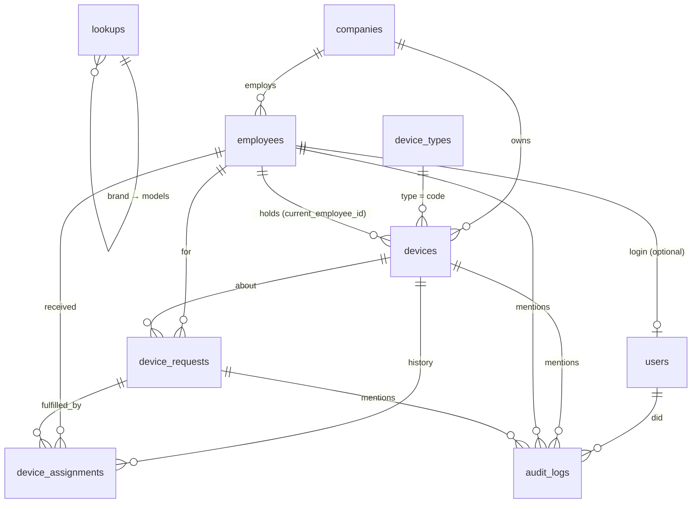
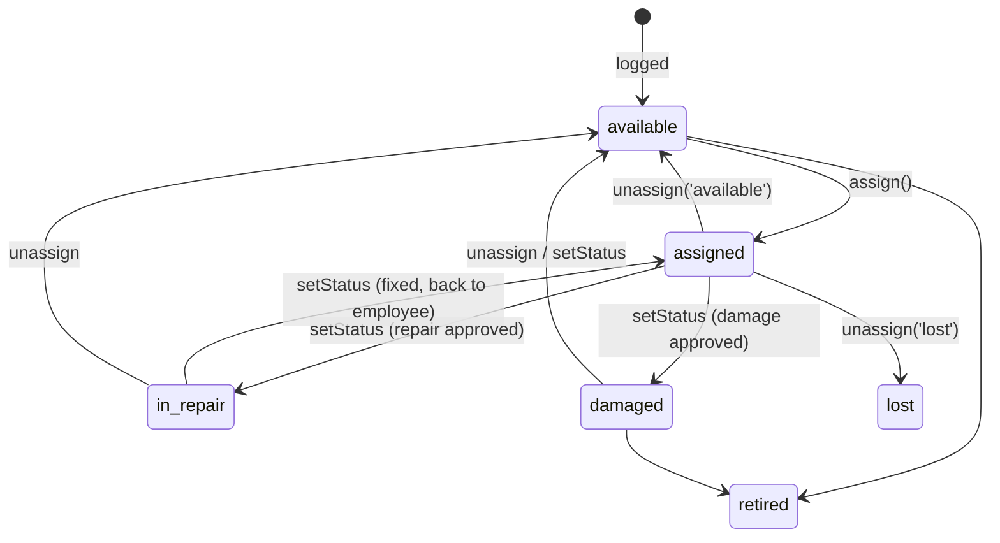

# IT Inventory: Developer Guide

Handover documentation for developers maintaining or extending the system.
For day-to-day use of the app, see the user guide deck (`docs/IT-Inventory-User-Guide.pptx`).

---

## 1. What the system does

IT Inventory is an internal web app for an **IT Support team that serves a group of companies**, possibly in several countries. It lets IT staff:

- keep an **asset register** of laptops, phones, monitors, gadgets and other devices, with specs, warranty and the purchase order (PO) file
- **hand devices to employees** and take them back, with a full history of who had what, and when
- file and process **requests** for employees: a new device, or repair, damage, lost and return reports
- see everything in an **audit log** (who did what, when) that can be exported to CSV
- maintain **master data**: companies, device types with asset-tag prefixes, and every dropdown list

There are two roles, both IT staff. Employees do not log in.

| | Super Admin | Admin |
|---|---|---|
| Devices, employees, assignments, requests, audit log | ✓ | ✓ |
| Approve / complete requests for **their own** devices | ✓ | ✗ (segregation of duties) |
| Master data, companies, device types, user accounts | ✓ | ✗ (403) |
| Type a new dropdown value while filling a form | ✓ (saved to master data) | ✗ (must pick from list) |

---

## 2. Stack

| Layer | Technology |
|---|---|
| Language / framework | PHP 8.2+ (developed on 8.5), **Laravel 13** |
| Database | **Microsoft SQL Server** (Express is fine) via `pdo_sqlsrv` |
| UI | Server-rendered **Blade**, **Bootstrap 5.3** + Bootstrap Icons, **Tom Select** (searchable dropdowns). All loaded from CDNs, so there is no npm build |
| Styling | `public/css/theme.css` (design tokens, light and dark themes) |
| Fonts | Plus Jakarta Sans, JetBrains Mono (Google Fonts) |
| Auth | Laravel session guard; `users` table; custom `role` middleware |
| Files | PO documents on Laravel's private `local` disk (`storage/app/private/po`) |

There is no API, no queue, no scheduler and no JS framework.

---

## 3. Local setup

**Requirements:** PHP with `sqlsrv` + `pdo_sqlsrv` extensions, Composer, SQL Server.

```bash
# 1. database
sqlcmd -S .\SQLEXPRESS -E -Q "CREATE DATABASE it_inventory"

# 2. app
composer install
cp .env.example .env        # then edit the DB_* values below
php artisan key:generate
php artisan migrate --seed  # schema + demo data
php artisan serve           # http://localhost:8000
```

`.env` database settings:

```dotenv
DB_CONNECTION=sqlsrv
DB_HOST='localhost\SQLEXPRESS'   # single quotes: the backslash breaks double quotes
DB_PORT=                         # empty for a named instance; or DB_HOST=localhost + DB_PORT=1433
DB_DATABASE=it_inventory
DB_USERNAME=                     # empty = Windows authentication
DB_PASSWORD=
```

**Demo logins** (seeded, password `password`): `superadmin@company.test` (Super Admin), `admin@company.test` (Admin).

> `php artisan migrate:fresh --seed` **drops every table**. Use it only on a dev/demo database.

---

## 4. Project map

```
app/
  Http/
    Controllers/
      AuthController.php            sign in / out
      Admin/
        DashboardController.php     dashboard figures
        DeviceController.php        devices + assign/return/status + PO file
        EmployeeController.php      employee records
        RequestController.php       request workflow (file → approve/reject → complete)
        AuditLogController.php      audit log page + CSV export
        MasterDataController.php    companies, device types, dropdown lists   (super admin)
        UserController.php          login accounts                            (super admin)
        CompanyScopeController.php  sidebar "Viewing company" switcher
    Middleware/EnsureRole.php       `role:` route middleware
  Models/                           Eloquent models (see §5)
  Support/
    Inventory.php                   device lifecycle operations (assign / unassign / setStatus)
    Lookups.php                     dropdown validation + saving super admin's new values
    CompanyScope.php                "viewing company" filter helpers
bootstrap/app.php                   middleware alias + guest redirect
database/
  migrations/2026_10_23_000001_*    core schema
  migrations/2026_10_23_000002_*    companies table + PO file columns (with data conversion)
  seeders/DatabaseSeeder.php        demo data
public/css/theme.css                the whole visual design
resources/views/
  layouts/app.blade.php             shell: sidebar, page header, alerts, Tom Select init
  partials/                         theme-head, theme-toggle, logs (activity table)
  components/                       <x-status> pill, <x-combo> master-data dropdown
  admin/…                           one folder per area
  auth/login.blade.php, errors/…    sign-in and themed 403/404/419 pages
routes/web.php                      all routes (see §8)
docs/                               this guide + user guide deck
```

---

## 5. Data model



| Table | Purpose / notes |
|---|---|
| `companies` | Companies of the group (`code`, `name`, `country`, `address`, `is_active`). |
| `employees` | People devices are issued to. `department` and `position` hold **text** from the master data. Deactivated, never deleted. |
| `users` | Login accounts. `role` = `super_admin` / `admin`; optional `employee_id`; `is_active`. |
| `device_types` | `code` (permanent key, stored in `devices.type`), `name`, `prefix` + `last_number` (asset tags), `has_computer_specs`, `has_imei`. |
| `lookups` | Dropdown options: `category`, `value`, `parent_id` (models → brand), `is_active`. Categories are listed in `Lookup::CATEGORIES`. |
| `devices` | The asset register. `asset_tag` auto-generated; brand/model/processor/etc. hold option **text**; `specs` JSON for extra specs; `status`; `company_id` (owner); `current_employee_id` (holder); `po_file_path` / `po_file_name`. |
| `device_assignments` | One row per hand-over. `returned_at` null = current holder. |
| `device_requests` | `reference_no` (`REQ-YYYYMMDD-XXXXX`), `request_type`, `status`, `priority`, `device_type` (new device) or `device_id`, who filed / handled it. |
| `audit_logs` | Append-only trail: `action` code, `description`, optional `changes` JSON (`field => [old, new]`), links to device / employee / request, `ip_address`. |

**Why text instead of foreign keys for dropdown values?** Records stay readable in reports and exports, and old values survive if an option is later deactivated. The cost is that renaming an option has to update records too. `MasterDataController::update()` does this, using the `table`/`column` in `Lookup::CATEGORIES`.

---

## 6. Key concepts and business rules

### 6.1 Roles and authorization
- Routes are grouped in `routes/web.php`: `role:super_admin,admin` for the app, plus a nested `role:super_admin` group for master data and users. `EnsureRole` returns 403 otherwise.
- Disabled accounts cannot sign in (`AuthController::login` adds `is_active = true` to the credentials).
- **Own-request rule:** an Admin whose account is linked to employee X cannot approve, reject or complete requests for X (`RequestController::ensureNotOwnRequest`). The Super Admin is exempt.
- A Super Admin cannot demote or disable their own account (`UserController::update`).

### 6.2 Master data and dropdowns (`App\Support\Lookups`)
- Forms render dropdowns with `<x-combo>` (or a `<select data-combo>`), which Tom Select turns into a searchable box. `data-combo="create"` lets **only the Super Admin** type a new value.
- Server side, always pair the two helpers:
  ```php
  // validation: admins must pick an active option (unchanged old values are allowed)
  'brand' => ['required', Lookups::rule('brand', $device?->brand)],
  // inside the save transaction: canonical spelling, creating the option if the super admin typed a new one
  $data['brand'] = Lookups::remember('brand', $data['brand']);
  $data['model'] = Lookups::remember('model', $data['model'], $data['brand']); // child: pass the parent
  ```
- An option that is in use can only be **deactivated** (hidden from dropdowns), not deleted.

### 6.3 Asset tags
`DeviceType::generateAssetTag($code)` locks the type row, increments `last_number`, skips any tag already taken, and returns e.g. `LT-0007`. Call it **inside a DB transaction**. Changing a device's type gives it a new tag. Changing a type's prefix only affects new tags.

### 6.4 Device lifecycle (`App\Support\Inventory`)
All holder and status changes go through three methods, each of which writes an audit entry. Callers wrap them in `DB::transaction()`.



- `assign()` only accepts **available** devices. Assigning to an employee of another company is allowed, and the audit log records it as a loan ("on loan from ASG to AHI").
- `unassign()` closes the open assignment (return date, condition, remarks). A lost device is logged as `device.lost`, not as a return.

### 6.5 Request workflow (`Admin\RequestController`)
```
pending ──approve──▶ approved ──complete──▶ completed
   ├──reject──▶ rejected   (reason required)
   └──cancel──▶ cancelled
```
| Type | On approve | On complete |
|---|---|---|
| `new_device` | none | assign the chosen available device |
| `repair` | device → `in_repair` | outcome: back to employee (`assigned`), stock, damaged or retired; optional replacement |
| `damaged` | device → `damaged` | same outcomes as repair |
| `lost` | device → `lost`, assignment closed | stays lost, found (stock) or retired; optional replacement |
| `return` | none | device back to stock with its condition |

Only **one open request per device** is allowed. Requests are always filed **by an admin for an employee** (`requested_by` = admin, `employee_id` = employee).

### 6.6 Multiple companies (`App\Support\CompanyScope`)
The sidebar switcher stores `company_scope` in the session. Lists, the dashboard and the audit log call `CompanyScope::apply()` (for tables with `company_id`) or `applyVia($query, 'employee')` (through a relation). Detail pages and forms are not restricted, so loans across companies remain possible.

### 6.7 Audit log
- Write entries **only** through `AuditLog::record($action, $description, $context)`.
- `$context` can carry `device`, `employee` and `request` (so the entry appears on their pages) and `changes`.
- Every action code must be listed in `AuditLog::ACTIONS`, which supplies the label and the filter dropdown. Its pill colour and icon come from `getActionStyleAttribute()`.
- Log rows are never updated or deleted.

### 6.8 Purchase order files
Uploaded in the device form (`po_file`: pdf, jpg, png, doc(x), xls(x), max 10 MB). They are stored by `DeviceController::savePoFile()` at `storage/app/private/po/{device id}/…` and served only through the signed-in route `admin.devices.po-file`. Replacing or removing a file deletes the old one from disk and is logged. **Include `storage/app/private` in backups.**

---

## 7. Front end

- **Layout:** `resources/views/layouts/app.blade.php`. Pages set `@section('title')`, optional `@section('actions')` (header buttons) and `@section('content')`. The eyebrow text above the title comes from the route name, or from `@section('eyebrow')`.
- **Theme:** `public/css/theme.css`. Colours are CSS variables at the top (`:root` for light, `[data-bs-theme="dark"]` for dark), and Bootstrap classes are restyled from them. Change colours there, never inline in views. The light/dark choice follows the OS, can be toggled in the sidebar, and is remembered in `localStorage`.
- **Components:** `<x-status :value="$device->status" />` renders a status pill. `<x-combo name="brand" :options="$list" :value="$current" required />` renders a master-data dropdown.
- **Dynamic forms:** the device form shows spec fields according to the device type, and filters models by the selected brand. The request form fills the device list and the employee snapshot from JSON passed by the controller. The scripts are inline at the bottom of each view (`@push('scripts')`).

---

## 8. Routes (all under `auth`)

| Method & URI | Name | Notes |
|---|---|---|
| GET `/admin` | `admin.dashboard` | |
| POST `/admin/company-scope` | `admin.company-scope` | sidebar switcher |
| resource `/admin/devices` (no destroy) | `admin.devices.*` | |
| POST `/admin/devices/{device}/assign`, `/return`, `/status` | `admin.devices.assign` … | modals on the device page |
| GET `/admin/devices/{device}/po-file` | `admin.devices.po-file` | streams the PO |
| resource `/admin/employees` (no destroy) | `admin.employees.*` | |
| GET/POST `/admin/requests`, GET `/admin/requests/create`, GET `/admin/requests/{id}` | `admin.requests.*` | `create` accepts `?employee=&device=&type=` |
| POST `/admin/requests/{id}/approve`, `/reject`, `/complete`, `/cancel` | | |
| GET `/admin/audit-logs`, `/admin/audit-logs/export` | `admin.audit.*` | same filters for both |
| `/admin/master-data*` | `admin.master.*` | **super admin** |
| resource `/admin/users` (no show/destroy) | `admin.users.*` | **super admin** |

Run `php artisan route:list --except-vendor` for the live list.

---

## 9. How to…

**Add a new dropdown list** (e.g. "Keyboard layout" on devices)
1. Migration: add a nullable string column to `devices`.
2. `Lookup::CATEGORIES`: add `'keyboard_layout' => ['label' => …, 'group' => 'Devices', 'table' => 'devices', 'column' => 'keyboard_layout']`. The Master Data page lists it automatically.
3. `Device::$fillable` + `DeviceController::LOOKUP_FIELDS` (this handles validation and saving).
4. Device form: `<x-combo name="keyboard_layout" :options="$options['keyboard_layout']" :value="$device->keyboard_layout" />`.
5. Show it on `admin/devices/show.blade.php`.

**Add a new audited action**
Add the code and label to `AuditLog::ACTIONS`, call `AuditLog::record()` where it happens, and adjust `getActionStyleAttribute()` if it needs its own colour.

**Add a request type**
Add it to `DeviceRequest::TYPES`, the type buttons and `data-for` blocks in `admin/requests/form.blade.php`, the `match` in `RequestController::approve()`, the branches in `complete()`, and the completion form in `admin/requests/show.blade.php`.

**Add a page**
Controller method → route inside the right role group → view extending `layouts.app` → sidebar entry in the `$nav` / `$superNav` arrays at the top of the layout.

**Change the look**
Edit the tokens at the top of `public/css/theme.css`. The stylesheet URL is versioned by file time, so browsers pick up changes on refresh.

---

## 10. SQL Server notes (gotchas)

- **Integer columns come back as strings** from `pdo_sqlsrv`. Models cast foreign keys to `integer`. Keep doing this for new FK columns, otherwise strict `===` comparisons fail silently (this was a real bug early on).
- **No multiple cascade paths:** all foreign keys use the default NO ACTION. Delete or deactivate in code instead.
- The default collation is **case-insensitive**: `'dell' = 'Dell'`. `Lookups::find()` relies on this.
- A unique index treats NULL as a value. `lookups (category, parent_id, value)` therefore allows one parent-less option per text, which is what we want.
- `.env` `DB_HOST` with a backslash must be in **single quotes**.

---

## 11. Deployment checklist

- `APP_ENV=production`, `APP_DEBUG=false`, set `APP_URL`. Serve over HTTPS.
- **Do not seed.** Create the first Super Admin with tinker, then change or remove the demo accounts:
  ```bash
  php artisan tinker --execute="App\Models\User::create(['name'=>'…','email'=>'…','password'=>'…','role'=>'super_admin']);"
  ```
- `php artisan migrate --force`, then `php artisan config:cache route:cache view:cache`.
- The web server user needs write access to `storage/` and `bootstrap/cache/`.
- **Back up** the database **and** `storage/app/private` (PO files).
- Sessions and cache use the database (`SESSION_DRIVER=database`, `CACHE_STORE=database`).

---

## 12. Testing and quality

Feature tests live in `tests/Feature` (40 tests). They run on **SQL Server**, like production, because some bugs, such as integer IDs coming back as strings, only show up there.

```bash
# once: create the test database (it is wiped on every run)
sqlcmd -S .\SQLEXPRESS -E -Q "CREATE DATABASE it_inventory_test"

php artisan test                         # whole suite (~15 s)
php artisan test --filter=RequestWorkflow   # one file
```

- `phpunit.xml` points the tests at `it_inventory_test`. As a safety guard, `tests/TestCase.php` refuses to run against any database whose name doesn't end in `_test`, because RefreshDatabase drops every table.
- Every test starts from the demo seed (`$seed = true`). Helpers such as `$this->admin()`, `$this->device('LT-0001')` and `$this->employee('EMP-0002')` fetch the known records.
- Coverage:
  - sign-in and roles
  - every page rendering for both roles
  - asset tags, dropdown rules, assign / return / status rules and PO files
  - every request type's approve and complete outcome, plus the own-request guard
  - master data renames, deletes, companies, device types and user accounts
  - company scoping and the audit log export
- Before every commit run `php artisan test` and `./vendor/bin/pint --test` (code style).
- When changing behaviour, check the audit log entry it writes. The audit log is the system's compliance record.

---

## 13. Known limitations and ideas

- No email or notification when a request is filed or handled.
- No bulk import (CSV) of devices or employees.
- Admins are not restricted to particular companies. The company switcher is a view filter, not a permission.
- No device photos or attachments other than the PO.
- No browser (JavaScript) tests. The feature tests cover the server side; the dropdown and form scripts were checked manually in Chrome.
